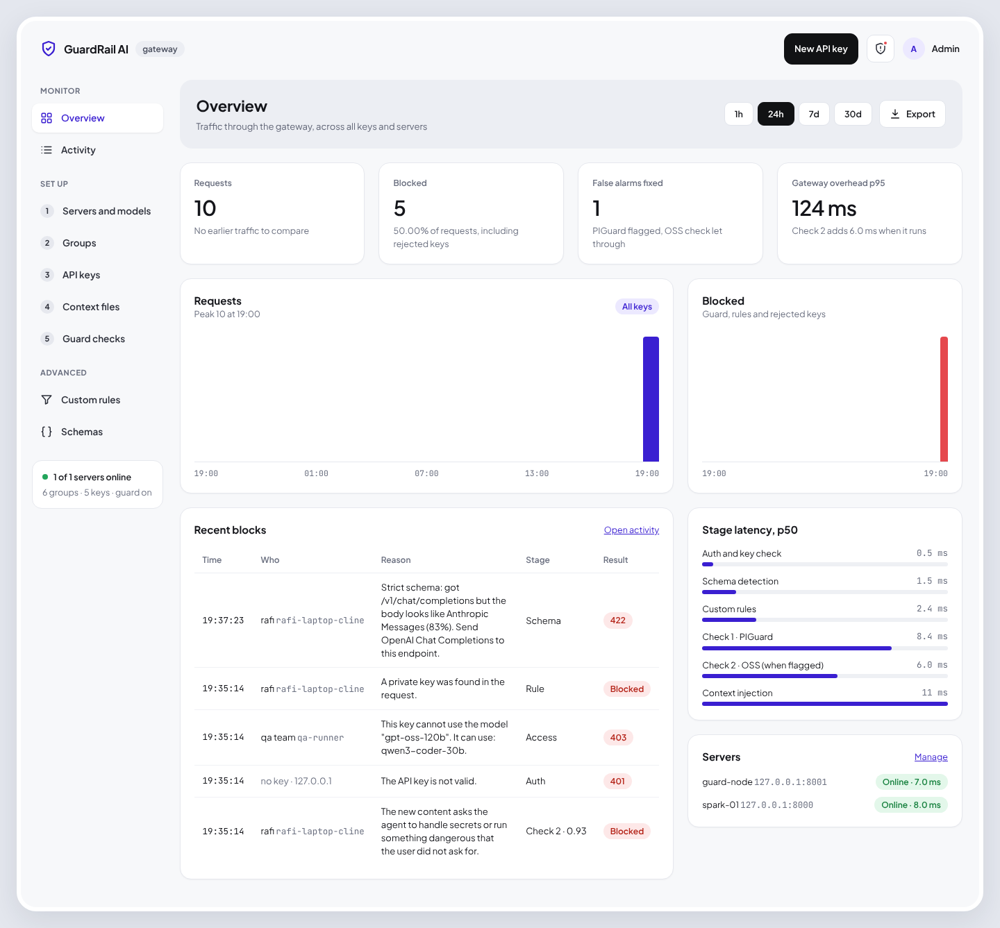
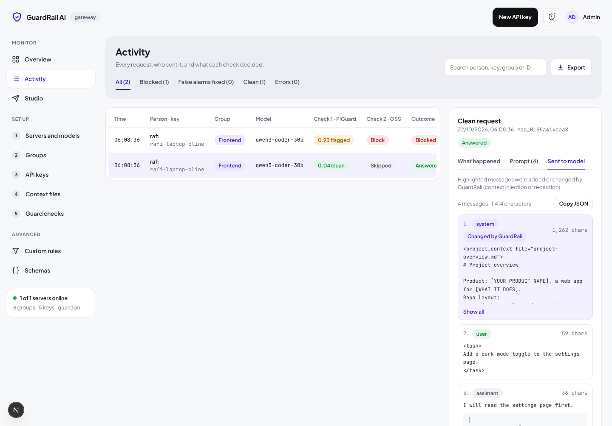

# GuardRail AI

GuardRail AI is a security gateway and admin panel for self-hosted vLLM servers. Coding agents such as Cline talk to it exactly as they would talk to an OpenAI-compatible endpoint. Before a request reaches a model, GuardRail does three things:

1. It checks the API key, the model the key asked for, and the rate limit.
2. It scans new content for prompt injection in two steps. PIGuard scores the content first, and gpt-oss-safeguard-20b confirms a flag or clears it as a false alarm.
3. It adds the group's role context (`.md` files) at the top of the prompt as a stable prefix, so vLLM prefix caching keeps working.

When a request is blocked, the agent receives a normal streamed assistant message explaining why, so Cline shows it in the chat instead of failing with an error.



## What's in the box

| Area | What it does |
| --- | --- |
| **Servers and models** | Add a vLLM server by URL. GuardRail discovers its models, and you choose which ones clients can use. Health, latency and prefix-cache hit rate are shown per server. You can set limits (rate limit, allowed groups) globally, per server or per model. |
| **Groups** | Groups form a tree, and every setting inherits down it. A child can **add** to the parent's list or **override** it. The *Effective rules* matrix shows where each value comes from. A group can also **turn the PIGuard check or the second check off** for all its keys (and a sub-group can switch it back on); everyone else follows the Guard checks page. |
| **API keys** | Keys look like `grk_live_…` and only a SHA-256 hash is stored. The secret is shown once, together with Cline setup steps. Each key belongs to a group and can carry its own exceptions, which act as one more layer on top of the group. |
| **Context files** | A library of `.md` files with version history. Each group chooses which files to include and in what order. The policy prompt and placement are set here (top of the system message for caching, or just before the last user message). |
| **Guard checks** | Check 1 is PIGuard, run through vLLM's `/classify`, with built-in patterns as a fallback. Check 2 is the OSS judge, which runs only on flagged requests. Each check has its own switch: turn PIGuard off and every request goes to check 2, whose answer decides; turn both off and requests go straight to the model. You pick a provider server for each check or add one inline. This page also edits the blocked-reply template and has a live tester. |
| **Studio** | A test bench. Choose a key (or paste one), a schema (OpenAI chat like Cline, legacy completions, Anthropic, Responses, Ollama, Gemini) and a scenario, then send. You see the reply as the agent would, each step GuardRail took, which context files it added and the exact request the model received. |
| **Activity** | Every request is logged with its outcome, stage timings and a step-by-step **Why?** timeline. Click any row to open it: **Prompt** shows every message the client sent (system prompt, user turns, tool calls and results), and **Sent to model** shows what reached vLLM, with the messages GuardRail added or changed (context, redaction) highlighted. You can filter, search, export to CSV, and mark false alarms. |
| **Custom rules** | WHEN/THEN rules that run before the guard. They match text or a regex in a chosen part of the request, can be scoped to a group, and can block, redact or escalate to check 2. |
| **Schemas** | Detects which API shape a request uses (OpenAI chat or completions, Responses, Anthropic, Ollama, Gemini). In strict mode a body that doesn't match its path is rejected with a 422. |



Full prompts are kept on disk, not in the database. Each request gets one Markdown file, `data/prompts/<YYYY-MM-DD>/<request id>.md`, holding a summary table, every message as the client sent it, every message as sent to the model, and the steps GuardRail took. The log row stores only that file's path, and the Activity page reads the file when you open a request. Files older than 20 days are deleted automatically (checked at most once an hour), while the log rows themselves stay. Change the folder with `GUARDRAIL_PROMPTS_DIR` and the period with `GUARDRAIL_PROMPT_RETENTION_DAYS`. Treat the folder as sensitive: it holds whatever your users and their agents send.

More screenshots are in [`docs/screenshots`](docs/screenshots). The original design mockup is in [`docs/mockup`](docs/mockup).

## Quick start

You need Node 20 or newer. `better-sqlite3` builds a native module when you install.

```bash
npm install
cp .env.example .env            # set GUARDRAIL_ADMIN_PASSWORD for anything non-local
npm run dev                     # http://localhost:3000
```

The first run creates `./data/guardrail.db` with an empty root group named "Everyone". From there:

1. **Servers and models**: add your vLLM URL (for example `http://10.0.1.5:8000`) and pick the models clients can use.
2. **Groups**: set which models and context files each team gets.
3. **API keys**: create a key for each person or bot.
4. **Context files**: upload your `.md` files and include them in groups.
5. **Guard checks**: point check 1 and check 2 at the server that runs PIGuard and gpt-oss-safeguard-20b.

### Try it without a GPU

`scripts/mock-vllm.mjs` is a small stand-in for vLLM. It serves models, chat and completions (with streaming), `/classify`, `/metrics`, and a judge.

```bash
npm run mock:vllm -- 8000 qwen3-coder-30b,gpt-oss-120b
npm run mock:vllm -- 8001 leolee99/PIGuard,openai/gpt-oss-safeguard-20b
npm run seed                    # demo groups, files, rules and keys; prints the key secrets
npm run dev
```

### Point Cline at it

In Cline, choose the **OpenAI Compatible** provider and fill in:

- **Base URL**: `http://<gateway-host>:3000/v1`
- **API key**: the `grk_live_…` secret
- **Model ID**: one of the models the key's group allows (`GET /v1/models` lists them)

## Running a vLLM guard server

```bash
# Check 1: PIGuard as a classifier
vllm serve leolee99/PIGuard --task classify --port 8001
# Check 2: the judge
vllm serve openai/gpt-oss-safeguard-20b --port 8002
```

Both can live on one server. On the Guard checks page, choose that server as the provider for each check. If PIGuard's server is unreachable, check 1 falls back to the built-in patterns. What happens when check 2 times out is set by "If it fails or times out".

## Configuration

| Variable | Default | Purpose |
| --- | --- | --- |
| `GUARDRAIL_DB` | `./data/guardrail.db` | SQLite file. |
| `GUARDRAIL_ADMIN_PASSWORD` | *(empty)* | When set, the admin panel and `/api/admin` require a login. The `/v1` gateway always uses API keys. |
| `GUARDRAIL_SECRET` | `change-me` | Signs the admin session cookie. Use a long random string. |
| `GUARDRAIL_ADMIN_NAME` | `Admin` | Name shown in the top bar. |

Everything else (guard thresholds, prompts, placement, schema policy, default rate limit) is stored in the database and edited in the UI.

## Production

```bash
npm run build
GUARDRAIL_ADMIN_PASSWORD=… GUARDRAIL_SECRET=… npm start
```

Run a single instance. Rate limits are counted in memory, and SQLite is a single file. Put TLS in front of it with your usual reverse proxy, and pass `X-Forwarded-For` so the log shows client IPs.

## Development

```bash
npm run lint
npm run typecheck
npm test          # unit tests plus gateway tests against the mock vLLM server
```

The code is laid out like this:

- `src/lib`: backend (database, gateway, guard, inheritance, logs).
- `src/app/v1`: the OpenAI-compatible gateway routes.
- `src/app/api/admin/[...path]`: the admin JSON API.
- `src/app/(admin)`: the UI pages.

See [docs/architecture.md](docs/architecture.md) for how a request flows through the gateway, and [docs/api.md](docs/api.md) for the HTTP API.

## Not built yet

- The mockup's **Pipeline** editor and **Python scripts** screens. The pipeline order is fixed in code.
- Translating between schemas. In strict mode a mismatched body is rejected; in "accept known" mode it is passed through to vLLM unchanged, not converted.
