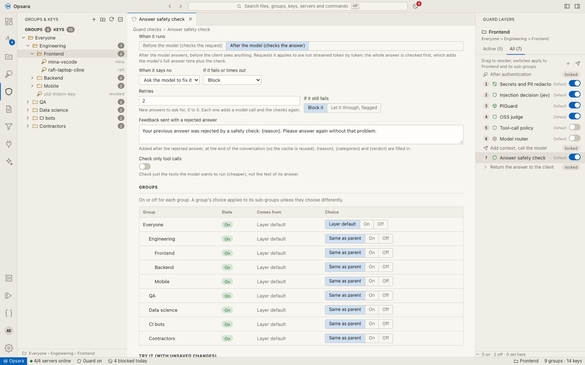

# Checks after the model

Most guard layers check the **request** before the model sees it. A layer with **When it runs:
after the model** (`stage: "output"`) checks the model's **answer** before the client sees any of it.

```
After authentication
  input layers…
Add context, call the model
  output layers…        ← this page
Return the answer to the client
```

Use output layers for:

- **Tool-call policy.** Stop `rm -rf`, `curl … | sh`, uploads of `.env`, or pushes to protected
  branches before the agent runs them. With **Only tool calls** on, the layer reads only the tool
  calls in the answer, which is smaller and cheaper.
- **Data leaks.** Catch secrets, internal hostnames or personal data that the model echoes back.
- **House rules.** Language, licence headers, "never edit generated files", and similar.

## What a failed answer does

| When it says no | Effect |
| --- | --- |
| `retry` (default) | The answer goes back to the model with the reason as feedback. This repeats up to **Retries** times (0–5, default 2). |
| `block` | The client gets the blocked reply. |
| `flag` | The answer is delivered and the request is logged as flagged. |
| `redact` | Matches in the answer are replaced with `[REDACTED]`. |

When the retries are used up, **When retries run out** decides: `block` (default) or `flag`.

### The retry message

After a rejected answer, Opsara sends the conversation again, followed by the rejected answer
and a user message built from **Retry prompt**:

```
Your previous answer was rejected by a safety check: {reason}. Please answer again without that problem.
```

`{reason}`, `{categories}` and `{verdict}` are filled in from the layer's decision. The conversation
is unchanged up to that point, so the provider's prompt cache is reused. Retries are also pinned to
the provider that just answered (see [caching.md](caching.md)).

## Streaming

A streaming client can't be shown an answer that might still be rejected. So for requests with
output layers, Opsara:

1. Calls the model and collects the full answer, including its tool calls and reasoning.
2. Runs the output layers, retrying if needed.
3. Sends SSE keep-alive comments while it waits, so the client doesn't time out.
4. Sends the approved answer as a normal `chat.completion.chunk` stream, ending with `[DONE]`.

Requests without output layers stream straight through, unbuffered.

## Placement

Output layers support **prefix** and **suffix** placement like input layers. With **suffix** and
**Use the request's model**, the check sends the whole conversation, plus the answer, plus the
question, to the same model and provider. Most of the prompt then comes from cache. Give suffix
checks a time limit of 15–30 s: they read the whole conversation, and a 5 s limit will time out on
long sessions.

## In Activity

Each attempt is logged separately: *Answer check · answer #1* (rejected, with reason), then
*answer #2*, and so on. The Summary tab shows the verdict, latency, cost and cache hits of each
attempt. The Session tab shows the final reply.


