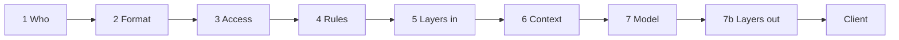

# Architecture

GuardRail is one Next.js app, started by `server.mjs`, with two jobs:

- **Gateway.** `src/app/v1/*` is an OpenAI-compatible API that agents call with a `grk_live_…` key.
- **Console.** `src/app/(console)/*` is the admin UI, and `src/app/api/admin/[...path]` is the JSON
  API behind it (`src/lib/admin-api.ts`). The previous panel still runs at `/old`.

`server.mjs` stamps every request with the real TCP peer address (`x-guardrail-peer`), which is used
for IP binding. A header sent by the client cannot override it.

All state lives in one SQLite file, accessed with `better-sqlite3` (`src/lib/db.ts`, migrated by
`SCHEMA_VERSION`). Full prompts and replies are stored as one Markdown file per request under
`data/prompts`.

## A request, step by step (`src/lib/gateway.ts`)

1. **Who is calling.**
   - The key comes from `Authorization: Bearer …` or `x-api-key`, and is looked up by its SHA-256
     hash. A revoked, expired or unknown key gets a 401.
   - If the key has an IP list (addresses or CIDR ranges), any other peer gets a 403.
2. **Format.** `detectSchema` scores the body against known API shapes (`src/lib/schemas.ts`).
   Under the strict policy, a body that confidently looks like a different shape gets a 422.
3. **Access and limits.**
   - The key's group chain is resolved, with the key's own exceptions as the last layer.
   - The model must be in the effective `models` list, and its server in `servers`. Otherwise the
     request gets a 403.
   - Limits (global, per server, per model) can narrow this further. The narrowest rate limit
     applies, counted in a one-minute sliding window, and a request over it gets a 429.
4. **Custom rules** (`src/lib/rules.ts`). A rule can block (stop the request with its message),
   redact (replace matches with `[REDACTED]`) or escalate (mark the request as flagged).
5. **Guard layers before the model** (`src/lib/pipeline.ts`). Enabled input layers run in order;
   see [guard-layers.md](guard-layers.md).
   - Each layer reads what it is set to read: new user messages, new tool results, the system
     prompt. "New" means after the last assistant turn.
   - A hit blocks, flags (later layers with scope `flagged` then run) or redacts.
   - A router layer picks the model ([routing.md](routing.md)).
   - Suffix layers send the request exactly as the model will get it ([caching.md](caching.md)).
   - A flag that no later layer clears is decided by **Flag nobody cleared**. A flag a later layer
     clears is logged as a false alarm.
6. **Context.** The context block is built in this order:
   - the caller line (`Request from: <owner> (API key: <name>)`, unless the key turns it off);
   - the policy prompt;
   - the group chain's context files, each in `<project_context file="…">` tags.

   It goes at the top of the first system message (or before the last user message). The same
   function builds the message list for the model call and for suffix checks.
7. **Call the model.**
   - The first healthy server that serves the model is called; on failure the next one is tried.
   - Anthropic and Gemini models get a cache breakpoint.
   - On OpenRouter, the provider that last served the model is requested.
   - Streams pass through unchanged and are collected for the log (`src/lib/stream-collect.ts`).

   7b. **Layers after the model.** If any output layers are on, the answer is collected first,
   checked, and retried with feedback if needed. It is then delivered, or blocked. See
   [after-model-checks.md](after-model-checks.md).

Every stage records its duration (`stages`), a readable step (`steps`), and each layer's decision
(`decisions`: verdict, score, reason, latency, cost, cache hits, provider, attempt). The Activity
Summary and the Studio debug panel draw from these.

### The blocked reply (`src/lib/sse.ts`)

A blocked request still gets HTTP 200 with an ordinary assistant message, so agents display it
instead of retrying. With `stream: true` it is an SSE stream of `chat.completion.chunk` events
ending in `[DONE]`. Otherwise it is a single `chat.completion`, or `text_completion` objects for
`/v1/completions`. The text comes from the group's template, with `{reason}` and `{request_id}`
filled in. The response carries `x-guardrail-blocked: 1`.

## Group inheritance (`src/lib/groups.ts`)

Groups form a tree under one root (**Everyone**). These settings inherit:

| Key | Kind |
| --- | --- |
| `servers`, `models`, `context` | lists |
| `layers` | per-layer on/off switches |
| `layer_opts` | per-layer additions (judge prompt lines, decision policy, threshold) |
| `blocked_reply` | text |
| `rate_limit` | number |

For each setting, a group stores either nothing (inherit) or one of these modes:

| Mode | Lists | Values |
| --- | --- | --- |
| `set` (root only) | the starting list | the starting value |
| `add` | parent's list plus these | — |
| `override` | replaces the parent's list | replaces the value |

`resolveLayers` walks the chain from the root to the leaf, starting from the global defaults, and
applies the key's exceptions last ("This key"). It returns the effective values, which group
contributed each one (`sources`), and the matrix the Groups page shows as **Effective**.

## Data model (`src/lib/db.ts`)

| Table | Holds |
| --- | --- |
| `servers`, `models` | Servers (address, encrypted API key, health) and their models: on/hidden, type, context size, price, `api` (`decisions` for Decisions-API models), `structured` output support |
| `groups` | Tree via `parent_id`. `settings` is JSON of `{key: {mode, value}}` |
| `api_keys` | Name, owner, group, prefix, hash, encrypted secret, exceptions, IP list, caller-line switches (`id_key`, `id_owner`), expiry, revoked, last used |
| `context_files`, `context_file_versions` | Markdown library with full history |
| `limits` | Scope `global` / `server` / `model`, rate limit, allowed groups |
| `rules` | Custom rules |
| `settings` | One JSON document of global settings, including the layer list (`src/lib/settings.ts`) |
| `request_logs` | One row per request: outcome, stages, steps, decisions, injected context, feedback label, test flag, and `prompt_file` (the Markdown file with the full prompt and reply) |
| `studio_scenarios` | Saved Studio scenarios |

Secrets (key secrets, server API keys) are encrypted with AES-256-GCM, using a key derived from
`GUARDRAIL_KEY_SECRET` or `GUARDRAIL_SECRET` (`src/lib/secret-box.ts`). Server keys never leave the
server: the console only sees whether one is saved.

## Admin auth

- If `GUARDRAIL_ADMIN_PASSWORD` is set, `src/middleware.ts` requires a session cookie on every
  console page and on `/api/admin/*`. The cookie is an HMAC token signed with `GUARDRAIL_SECRET`.
- `/v1/*`, `/login` and `/api/auth/*` are exempt.
- With no password set, the console is open, which is meant for local development.
