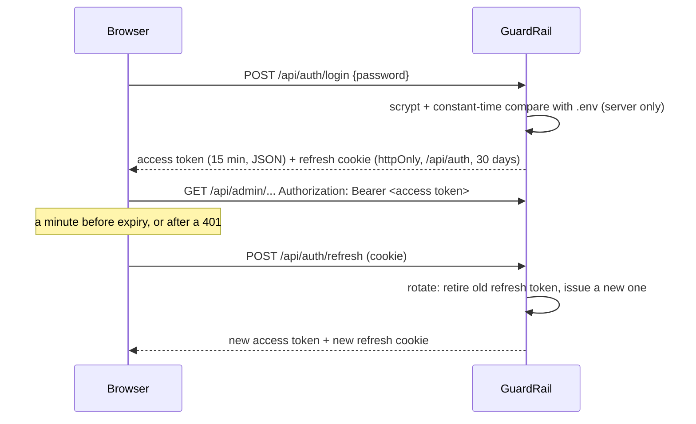

# Console sign-in and security

The console and its admin API are protected by `GUARDRAIL_ADMIN_PASSWORD` from `.env`. With no
password set the console is open, which is only meant for your own machine. The gateway (`/v1`) and
the MCP server (`/mcp`) are separate: they use GuardRail API keys.

## How sign-in works

- **The password is only checked on the server.** It is hashed with scrypt (random salt per
  process) and compared in constant time. It never reaches the browser bundle.
- **Access token.** `gra1.<payload>.<HMAC-SHA256>`, signed with a key derived from
  `GUARDRAIL_SECRET`. It expires after 15 minutes and is kept **in memory only**: never in
  `localStorage` or a readable cookie. Every admin API call sends it as `Authorization: Bearer`.
  That also makes the API immune to CSRF, because a cross-site page cannot add the header.
- **Refresh token.** 32 random bytes, stored in the database only as a SHA-256 hash, sent as an
  `httpOnly`, `SameSite=Strict` cookie that only goes to `/api/auth` (and `Secure` over https).
- **Rotation and reuse detection.** Every refresh retires the old refresh token and issues a new one
  in the same *session family*. If a retired token is ever used again, it was copied, so the whole
  family is revoked and that sign-in must start over.
- **Checked twice.** The middleware verifies the token's signature and expiry. The API handler
  checks it again and refuses tokens whose family was signed out.
- **Login limits.** Five wrong passwords from one address lock it out for a minute, then 2, 4, 8…
  up to an hour. The error message is the same whatever was wrong.
- **Same-origin only.** Login, refresh and logout refuse requests from other sites.
- **Audit log.** Sign-ins, failures, lockouts, refreshes reused after rotation, and sign-outs are
  recorded with time, IP and browser.

Console pages hold no data. Without a sign-in they redirect to `/login` (a non-secret `gr_in`
cookie tells the middleware this browser has signed in). Everything else comes through the
protected API.

## Signed-in browsers

**Settings › Account** lists each sign-in (browser, IP, start, last use) with **Sign out** per
browser and **Sign out everywhere**, plus recent sign-in events.

## Recommendations

- Set a long random `GUARDRAIL_SECRET`. It signs access tokens and encrypts stored secrets.
  Changing it signs everyone out and makes stored key secrets unreadable (rotate the keys).
- Set `GUARDRAIL_ADMIN_PASSWORD` to a long passphrase on anything but your own machine.
- Serve the console over https, so the refresh cookie is also marked `Secure`.
- Behind a reverse proxy, turn on *trust proxy* so login limits and the audit log see the real
  client address.

## API

| Method | Path | Notes |
| --- | --- | --- |
| POST | `/api/auth/login` | `{password}` → `{accessToken, expiresAt}` and the refresh cookie. 401 wrong password, 429 locked out (`Retry-After`). |
| POST | `/api/auth/refresh` | Uses the refresh cookie → new `{accessToken, expiresAt}`, rotates the cookie. |
| POST | `/api/auth/logout` | Ends this sign-in (its whole family) and clears the cookies. |
| GET | `/api/admin/auth/sessions` | Signed-in browsers and recent sign-in events. |
| POST | `/api/admin/auth/sessions/:family/revoke` | Sign one browser out. |
| POST | `/api/admin/auth/logout-all` | Sign out everywhere. |
