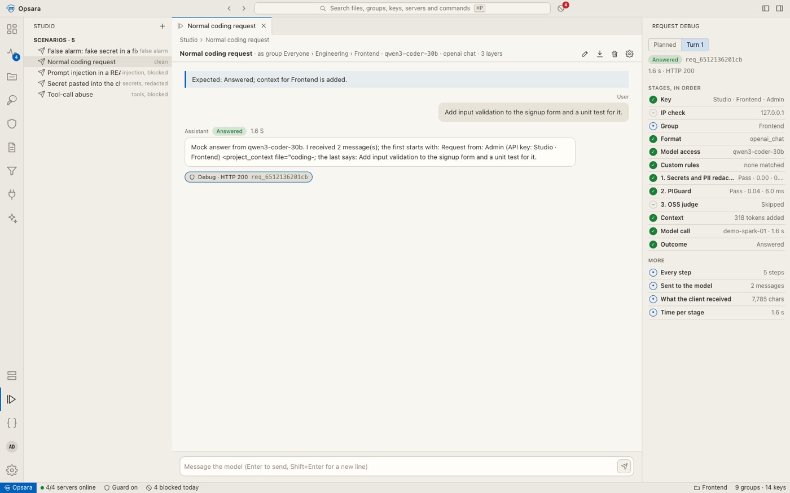
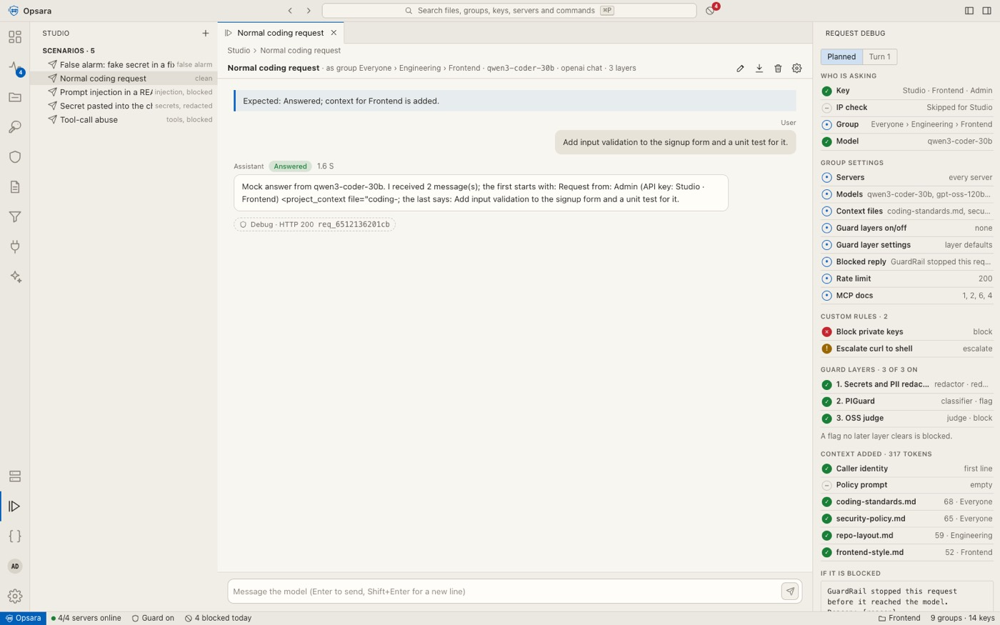

# Studio

Studio is a chat test bench inside the console. Every message goes through the **real gateway**
(auth, rules, guard layers, context, the model, after-the-model checks), exactly like a client
request, so what you see is what an agent would get.

## Scenarios

A scenario saves everything needed to repeat a test:

- **Who**: act as a key, or as a group (Studio then uses a built-in key for that group).
- **Model, endpoint and streaming**: chat or completions.
- **Starting messages**: for example a README with a hidden instruction, or a tool result with a
  fake secret.
- **Layers**: optionally run only some layers.
- **Expected result**: for example "blocked by the injection layer" or "answered, context added".

The demo data includes five scenarios: a normal request, prompt injection in a README, a secret
pasted into the chat, tool-call abuse, and a false alarm.

Scenarios can be edited, downloaded as JSON and deleted from the header.

## Live run

Press **Enter** to send (**Shift+Enter** adds a new line). While the request runs:

- Tokens stream into the chat as they arrive, and the chat follows them to the bottom.
- The **Request debug** panel on the right fills in step by step: who is asking, the group settings
  that applied, custom rules, each guard layer as it starts and finishes (verdict, score, reason,
  latency), the context files added, the model call, and the after-the-model checks with their
  retries.

The live view uses `POST /api/admin/studio/live`, which returns a server-sent event stream: `step`,
`layer`, `model`, `draft` and `token` events, then a final `result` event.

## Planned vs last turn

Before you send anything, **Planned** shows what *will* apply: the key, IP handling, group chain,
servers, models, context files with their token counts, layer switches, custom rules and the
blocked-reply template. **Last turn** shows what actually happened on the latest message.

## Notes

- Studio skips a key's IP binding, since the request comes from inside the console. Everything else
  is the same.
- Studio requests are logged in Activity and marked as test traffic. Activity can hide or show them.
- To test a single layer without a conversation, use **Guard checks › Test**
  (`POST /api/admin/guard/test-live`).
- To repeat a logged request, open it in Activity and use **Replay**.
